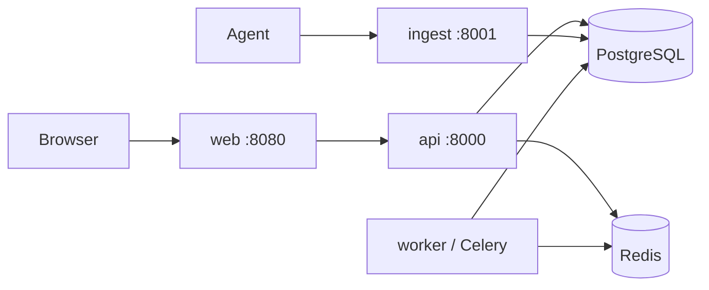

# SAMoparser — командный каркас

Репозиторий предназначен как стартовая площадка для команды, а не как готовая SAM-система. Здесь есть запускаемый контейнерный каркас сервисов, локальная инфраструктура, Helm-шаблон и CI/CD; доменная логика SAM, миграции и функции ИИ реализуются по плану работ.

## Архитектура



- `services/backend` — общий Python-образ и минимальные entrypoints `app.api`, `app.ingest`, `app.worker`.
- `services/web` — SPA на React 19 / Vite 6 / react-router-dom / lucide-react: дашборд, комплаенс-контроль, справочники, импорт, очередь проверки имён и офлайн ИИ-сервисы поверх публичного API; nginx reverse proxy. Подробности и запуск: [`services/web/README.md`](services/web/README.md).
- `services/agent` — пример отправителя, который команда заменит полноценным Windows/Linux collector.
- `deploy/helm/sam` — umbrella-чарт с отдельными Deployment для API, ingest, worker и web.
- В Kubernetes по умолчанию PostgreSQL и Redis остаются внешними. Для hackathon-профиля `values-hackathon.yaml` включает одноэкземплярные встроенные PostgreSQL (`pgvector/pgvector:pg16`) и Redis (`redis:7.2`) с PVC; это удобство для single-node стенда, а не HA или production-ready база данных.

Детальная архитектура: [`docs/architecture.md`](docs/architecture.md). Поэтапный backlog: [`docs/implementation-plan.md`](docs/implementation-plan.md).

## Допущения

1. Для MVP выбран общий backend package/image с разными entrypoints: это снижает дублирование, но не является окончательной границей микросервисов.
2. Redis предусмотрен как Celery broker/cache; предполагаемый источник истины — PostgreSQL. Реальная интеграция приложения ещё не реализована.
3. Helm требует заранее созданный Secret. PostgreSQL и Redis по умолчанию внешние; hackathon-профиль включает встроенные экземпляры.
4. Migration hook выключен (`migrations.enabled=false`), потому что в scaffold нет Alembic-моделей и миграций. Включать его можно только после реализации миграционного пакета и review.
5. Для векторов целевой основной путь — pgvector; fallback `float8[]/jsonb` и cosine similarity должен быть отдельной задачей этапа 6.
6. OpenAI API, JWT, авторизация по API-ключу и расширенная аналитика реализуются по плану. Минимальные CRUD, сопоставление, расчёт лицензий и панель управления уже добавлены в тестовый прототип.
7. Указанные образы и `sam.example.com` — placeholders; registry и домен задаются через CI variables/Helm values.

## Локальный запуск

Нужны Docker с Compose и работающим Docker daemon, а для генерации `.env` — Python 3. Запуск `./scripts/dev.sh` без аргументов открывает интерактивное меню: создание локального env, запуск, остановка, статус, логи всех или выбранных через пробел сервисов, а также отдельные пункты подготовки Kubernetes Secret и развёртывания. Для выхода выберите `0`. Без интерактивного ввода используйте явные команды ниже; отсутствие ввода не запускает развёртывание.

```bash
./scripts/dev.sh env
./scripts/dev.sh up
curl http://localhost:8000/health
curl http://localhost:8001/ready
open http://localhost:8080
```

Полезные команды:

```bash
./scripts/dev.sh status
./scripts/dev.sh logs api worker
./scripts/dev.sh config
./scripts/dev.sh restart
./scripts/dev.sh down

# Альтернативно через Makefile
make up
make down
make logs
make build
make test
make lint
make helm-lint
```

`./scripts/dev.sh env` не перезаписывает существующий `.env`. `env --force` может заменить существующий файл, только если удалось определить проект Compose и подтвердить отсутствие его `postgres-data` volume, а файл не содержит переопределений `COMPOSE_`. **При замене теряются все существующие настройки `.env`**, а не только учётные данные; заранее сохраните необходимые настройки. Для генерации нужны Python 3 и Docker. Если `.env` отсутствует, любой Compose volume с меткой `postgres-data`, независимо от проекта, блокирует генерацию; восстановите исходный `.env` и имя проекта из доверенной резервной копии. При ошибке проверки volume или определения проекта генерация также прерывается. Файл создаётся с правами `0600`. **Смена файла не меняет пароль в существующем PostgreSQL volume**: сохраните данные и согласуйте пароль базы и `DATABASE_URL` вручную. Не публикуйте `.env` и секреты; `config` вызывает `docker compose config --quiet` для проверки, не печатая содержимое конфигурации.

`make migrate` запускает Alembic-миграции в контейнере. `make seed` пока оставлен точкой расширения.

## Hackathon: подготовка Kubernetes

Это ручной процесс для доверенного одноузлового стенда, не подтверждение работоспособности в конкретном кластере. В hackathon-профиле worker и миграции выключены до реализации. Требуются `kubectl`, Helm, Python 3, доступ к выбранному контексту и заранее созданный namespace с правами на Secret, PVC и ресурсы Helm. До запуска проверьте StorageClass командой `kubectl --context CONTEXT get storageclass`: для PVC нужен работающий provisioner и default StorageClass либо явно заданные `postgresql.persistence.storageClass` и `redis.persistence.storageClass`. Размеры по умолчанию — 8Gi и 4Gi соответственно. При отсутствии подходящего класса PVC могут остаться Pending.

Чарт по умолчанию ссылается на placeholders `ghcr.io/example/sam-backend:latest` и `ghcr.io/example/sam-web:latest`: соберите и опубликуйте реальные образы, доступные узлу, настройте registry credentials / `imagePullSecrets` при необходимости. Узлу также нужен доступ к `pgvector/pgvector:pg16` и `redis:7.2`. Меню deploy использует `values-hackathon.yaml` и не запрашивает overrides образов или StorageClass: настройте их в values перед установкой либо выполняйте Helm вручную с отдельным файлом overrides. Не помещайте секреты в values.

1. Вызовите `./scripts/dev.sh`, выберите **6) Prepare Kubernetes Secret**, укажите release, namespace и context и проверьте их перед явным подтверждением `y`. Отмена не создаёт Secret. Скрипт создаёт отдельный `.env.kubernetes` с правами `0600` и Secret `<release>-sam-secrets`; локальный `.env` не используется. Существующий Secret не перезаписывается и автоматически не считается корректным. При отсутствии Secret скрипт проверяет PostgreSQL PVC конкретного release по имени `data-<release>-sam-postgresql-<номер>`; другие PVC в namespace сами по себе подготовку не блокируют. Если такой PVC существует, остановитесь: вручную восстановите исходный Secret **только из доверенной резервной копии** в тот же context и namespace, без ротации, и проверьте учётные данные базы до развёртывания. Если Secret отсутствует и такого PVC нет, существующий `.env.kubernetes` не перезаписывается, но может повторно использоваться после проверки владельца, прав, содержимого и целевого release/namespace/context. При ошибке или неизвестном результате создания Secret сохраните файл и проверьте состояние назначения, не генерируя новые пароли вслепую.
2. Выберите **7) Deploy Kubernetes**, повторно укажите те же release, namespace и context и подтвердите. Скрипт проверяет только наличие Secret, а не соответствие его учётных данных базе, и вызывает `helm install` с hackathon values только для нового release. Существующий release скрипт не обновляет; для обновления используйте Helm вручную, предварительно проверив необходимые overrides, в том числе образы и StorageClass. Скрипт фиксирует имена через `nameOverride` и `fullnameOverride`. Это не проверка готовности приложения или базы; после установки отдельно проверьте ресурсы и их логи.
3. До использования данных проверьте аутентифицированное подключение PostgreSQL и расширение `vector`, запись Redis и восстановление записи после перезапуска с сохранённым PVC. Проверяйте восстановление из независимых резервных копий. Redis использует AOF, но очередь всё равно может терять данные; PVC и AOF не являются backup или гарантией доставки. PVC предполагается сохранять при удалении StatefulSet; проверяйте поддержку политики и реальные PV в своём кластере.

Встроенные PostgreSQL и Redis рассчитаны на доверенную сеть: для них здесь не настроены TLS, а Redis не защищён аутентификацией. Инициализация pgvector выполняется только на новом volume. Изменение Secret не меняет пароль уже инициализированной базы: сохраняйте исходные учётные данные и согласованно проводите ручную ротацию в самой базе и Secret. Не удаляйте PVC для исправления пароля или повторной инициализации без проверенной резервной копии.

## Секреты Kubernetes

Чарт сам Secret не создаёт. Для внешних сервисов подготовьте его безопасным способом вне Git и укажите имя в `existingSecret`; нужны ключи `DATABASE_URL`, `REDIS_URL`, `JWT_SECRET`, `AGENT_API_KEY`, `OPENAI_API_KEY`. Встроенному PostgreSQL дополнительно нужны `POSTGRES_USER`, `POSTGRES_PASSWORD`, `POSTGRES_DB`, согласованные с URL. Не передавайте реальные секреты в аргументах команд и не публикуйте файлы, логи или вывод диагностики с ними. Kubernetes Secret требует контроля доступа и защиты хранения; для production рассмотрите Sealed Secrets или External Secrets. Подробности values и ограничений — в [`deploy/helm/sam/README.md`](deploy/helm/sam/README.md).

## VK Cloud deploy

1. Создать Managed Kubernetes, внешнюю VK Cloud DBaaS PostgreSQL и Redis-compatible managed service.
2. Создать registry и задать GitHub repository variables `VK_REGISTRY`, `VK_IMAGE_NAMESPACE`.
3. Добавить secrets `VK_REGISTRY_USERNAME`, `VK_REGISTRY_PASSWORD`, `KUBECONFIG_BASE64`.
4. В environment `dev`/`prod` задать `HELM_EXISTING_SECRET`, `HELM_NAMESPACE`, `HELM_RELEASE_NAME`.
5. Merge в `main` публикует SHA-образы и запускает dev deploy.
6. Git tag `v1.2.3` публикует semver-теги; production запускается вручную через защищённый environment.

Ingress использует ingress-nginx. TLS можно включить через `values-prod.yaml` и cert-manager annotation/ClusterIssuer.

Откат:

```bash
helm history samoparser -n prod
helm rollback samoparser REVISION -n prod --wait
```

## Что команда реализует дальше

Работу вести по [`docs/implementation-plan.md`](docs/implementation-plan.md): сначала ADR/security/API contracts, затем auth skeleton, SQLAlchemy/Alembic и RLS, idempotent ingest, parsing/PII, matching/vector fallback, safe assistant, UI и только после этого включать migration Job.

Каждый этап должен добавлять тесты, обновлять OpenAPI/ADR и явно отделять реализованное от TODO. Ответы ИИ до проверки человеком считаются рекомендациями, а не установленными фактами.
